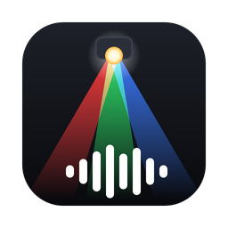

<p align="center"></p>

# Gonzo – controllo vocale per QLC+

**Gonzo** permette di comandare le luci di [QLC+](https://www.qlcplus.org/) con la voce, durante le prove e sul palco.
Dici **"gonzo rosso"**, **"gonzo scena tre"**, **"gonzo spegni tutto"** e Gonzo preme il pulsante giusto della Virtual Console di QLC+.

- **Offline**: il riconoscimento vocale ([Vosk](https://alphacephei.com/vosk/)) gira sul computer, senza internet.
- **In italiano**, con parola d'attivazione ("gonzo") e un elenco chiuso di comandi: meno falsi comandi con la band che suona.
- **Gate regolabile**: sotto la soglia Gonzo non ascolta.
- **Finestra di controllo**: microfono, livello, ultimo comando, lista dei comandi ricevuti e pulsanti per inviarli con un clic. Modalità compatta per affiancarla a QLC+.
- **macOS, Windows e Linux**. Gratuito e open source (GPL-3.0).

> *English: Gonzo is a free, offline voice-control app for QLC+. Say "gonzo &lt;command&gt;" and it triggers QLC+ Virtual Console buttons via OSC. Italian commands for now; English is planned.*

Creato da Leonardo Gon per il light show della sua band.

---

## 1. Scaricare e installare

Scarica il file per il tuo sistema dalla pagina [**Releases**](../../releases):

| Sistema | File |
|---|---|
| Mac con chip Apple (M1, M2, M3, M4…) | `Gonzo-macOS-AppleSilicon.zip` |
| Mac con processore Intel | `Gonzo-macOS-Intel.zip` |
| Windows 10 / 11 | `Gonzo-Windows.zip` |
| Linux (x86_64) | `Gonzo-Linux-x86_64.tar.gz` |

Non sai che Mac hai? Menu Apple → *Informazioni su questo Mac*: "Chip Apple" oppure "Processore Intel".

### macOS
1. Apri lo zip e trascina **Gonzo** in *Applicazioni*.
2. Primo avvio: macOS avvisa che l'app non è verificata (Gonzo è gratuito e non firmato da Apple). Vai in *Impostazioni di Sistema → Privacy e sicurezza* e premi **Apri comunque**.
   Se invece dice che l'app "è danneggiata", apri il Terminale e scrivi:
   `xattr -dr com.apple.quarantine /Applications/Gonzo.app`
3. Consenti l'accesso al **microfono** quando richiesto.

### Windows
1. Tasto destro sullo zip → *Proprietà* → spunta **Sblocca** → OK. Poi tasto destro → *Estrai tutto*, per esempio in `Documenti\Gonzo`.
2. Avvia **Gonzo.exe**. Se compare "Windows ha protetto il PC": *Ulteriori informazioni* → **Esegui comunque**.
3. Se Gonzo non sente nulla: *Impostazioni → Privacy e sicurezza → Microfono* → consenti l'accesso alle app desktop.

### Linux
```bash
sudo apt install libportaudio2        # libreria audio (Debian/Ubuntu)
tar -xzf Gonzo-Linux-x86_64.tar.gz
./Gonzo/Gonzo
```
Su Linux la finestra di Gonzo si apre nel browser (stessa interfaccia). Per chiudere usa **Esci** nella pagina.

---

## 2. Collegare QLC+

1. **Ingresso OSC** – In QLC+, *Ingressi/Uscite* → Universo 1 → riga **OSC** su `127.0.0.1` → attiva **Input** (porta 7700 per l'universo 1).
2. **Un pulsante per comando** – Nella Virtual Console crea un pulsante per ogni comando e collegalo alla sua funzione (scena, chaser…).
3. **Collega il pulsante a Gonzo** – Proprietà del pulsante → *Controlli esterni* → **Auto Detect**, poi clicca lo stesso comando nella finestra di Gonzo: QLC+ registra il percorso OSC (es. `/gonzo/rosso`).
4. **Modalità** – Usa **Toggle**. Per i colori metti i pulsanti in un **Solo Frame**: un solo colore acceso alla volta.

Chiudi QLC+ prima di usare `osc_monitor.py` per i test: usano la stessa porta.

---

## 3. Usare Gonzo

- Parla così: **"gonzo" + comando** (es. "gonzo scena due").
- **Microfono**: sceglilo dal menu in alto. Meglio un headset o un microfono vicino alla bocca: il microfono interno del computer sente troppo la band.
- **Gate**: con la band che suona e nessuno che parla, clicca sulla barra del livello poco più a destra di dove arriva. La barra diventa grigia quando il gate è chiuso, verde quando ascolta.
- **Comandi**: lista verde = eseguiti, gialla = scartati perché incerti, grigia = frasi senza comando.
- **Pausa** blocca solo la voce; clic e tastiera funzionano sempre.
- **Compatta** nasconde i pulsanti e dimezza la finestra, per affiancarla a QLC+.

### Modificare i comandi
*Modifica comandi…* (su Mac nel menu **Edit**, `Cmd+,`; su Windows e Linux il pulsante **Comandi…**) apre `config.yaml`. Dopo le modifiche riavvia Gonzo.

```yaml
commands:
  - { say: rosso,      osc: /gonzo/rosso }
  - { say: scena tre,  osc: /gonzo/scena3 }
  - say: [stop, ferma tutto]        # più frasi per lo stesso comando
    osc: /gonzo/stop
```
Usa parole italiane comuni: le parole che il modello non conosce non verranno mai riconosciute.
Se partono comandi non detti alza `min_confidence`; se ne perde, abbassalo.

Dove si trova `config.yaml`:
- macOS: `~/Library/Application Support/Gonzo/`
- Windows: `%APPDATA%\Gonzo\`
- Linux: `~/.config/gonzo/`

Nella stessa cartella ci sono `settings.json` (microfono, gate, vista compatta) e `gonzo.log` (utile per capire cosa ha sentito Gonzo).

---

## 4. Dal codice sorgente (sviluppatori)

Serve Python 3.10+.
```bash
./setup.sh        # macOS / Linux: ambiente Python + modello italiano (~50 MB)
./run.sh          # avvia Gonzo
```
Opzioni utili di `gonzo.py`: `--list-devices`, `--device N`, `--dry-run`, `--no-mic`, `--print-grammar`.
`osc_monitor.py` mostra i messaggi OSC inviati, per provare senza QLC+.
Su Mac, `make_app.sh` crea un piccolo Gonzo.app che avvia la versione sorgente.

Le app vengono costruite automaticamente da GitHub Actions (`.github/workflows/build.yml`) con PyInstaller (`gonzo.spec`). Un tag `vX.Y.Z` pubblica una nuova Release.

---

## Licenza

Copyright © 2026 Leonardo Gon.
Gonzo è software libero: puoi ridistribuirlo e modificarlo secondo i termini della **GNU General Public License v3.0** o successiva (vedi [`LICENSE`](LICENSE)). È distribuito senza alcuna garanzia.
Componenti di terze parti: vedi [`THIRD_PARTY_NOTICES.md`](THIRD_PARTY_NOTICES.md).

QLC+ è un progetto indipendente; Gonzo non è affiliato a QLC+.
